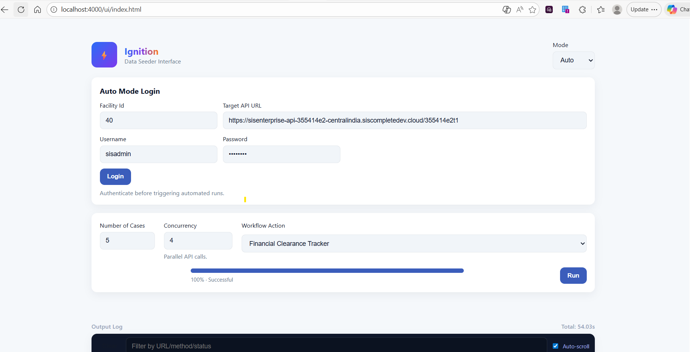

# ⚡ Ignition

**Automated test-data seeder for the SIS Complete platform.**

Ignition drives the target system's REST APIs to create patients, cases, discharges, coded procedures, charge entries, and insurance records — all through a browser-based UI.

---

## Table of Contents

- [Features](#features)
- [Tech Stack](#tech-stack)
- [Getting Started](#getting-started)
- [NPM Scripts](#npm-scripts)
- [Architecture](#architecture)
- [Project Structure](#project-structure)
- [Modes of Operation](#modes-of-operation)
  - [Manual Mode](#manual-mode)
  - [Auto Mode](#auto-mode)
- [Workflow Pipeline](#workflow-pipeline)
  - [Per-Patient Flow](#per-patient-flow)
  - [Flow Depth](#flow-depth)
  - [Case Status Progression](#case-status-progression)
- [Server Endpoints](#server-endpoints)
- [Service Modules](#service-modules)
  - [Patient Service](#patient-service)
  - [Case Summary Service](#case-summary-service)
  - [Discharge Service](#discharge-service)
  - [Coding & Charge Entry Service](#coding--charge-entry-service)
  - [Insurance Service](#insurance-service)
  - [Support Service](#support-service)
- [JSON Templates](#json-templates)
- [API Endpoints Hit](#api-endpoints-hit)
- [Configuration](#configuration)
- [Environment Variables](#environment-variables)

---

## Features

- **Two operating modes** — fully manual with fine-grained control, or fully automatic with randomized data
- **Configurable workflow depth** — create cases only, or go all the way through discharge → coding → charge entry
- **Concurrent patient creation** — configurable concurrency (1–25 workers) with batching (120 per batch)
- **Insurance pipeline** — creates carrier → claim office → plan → per-patient binding (primary / secondary / tertiary)
- **Dynamic reference data** — fetches rooms, appointment types, physicians, CPT codes, periods/batches, and insurance carriers from the live API
- **Retry logic** — exponential backoff on UpsertCaseSummary (up to 4 attempts)
- **Structured API logging** — every outgoing request is captured with method, URL, status, and duration
- **Browser UI** — single-page interface with searchable dropdowns, multi-select CPT picker with per-code amounts, workflow slider, and real-time error log

---

## Tech Stack

| Layer | Technology |
|-------|-----------|
| Runtime | Node.js with TypeScript |
| Server | Express 4 |
| HTTP Client | Axios |
| Object Merging | deepmerge |
| Dev Tooling | ts-node, nodemon, TypeScript 5.x |

---

## Getting Started

### Prerequisites

- **Node.js** ≥ 18
- **npm** ≥ 9

### Installation

```bash
git clone <repository-url>
cd Ignition
npm install
```

### Running the Server

```bash
# Production
npm start

# Development (auto-reload on file changes)
npm run dev:server
```

The server starts on **http://localhost:4000** by default. Open **http://localhost:4000/ui/** in a browser to access the interface.

---

## NPM Scripts

| Script | Command | Description |
|--------|---------|-------------|
| `npm start` | `ts-node server/server.ts` | Start the Express server |
| `npm run dev:server` | `nodemon --config nodemon.json` | Start with auto-reload (watches `server/` and `src/`) |
| `npm run build` | `tsc -p .` | Compile TypeScript to `dist/` |
| `npm run seed` | `ts-node src/runner.ts` | CLI seeder entry point (placeholder) |
| `npm run dev` | `nodemon src/runner.ts` | Dev mode for CLI seeder |

---

## Architecture

```
┌─────────────────────────────────────────────────────────────┐
│                     Browser UI (index.html + ui.js)         │
│  Manual Mode: full control    Auto Mode: one-click seeding  │
└────────────────────────────┬────────────────────────────────┘
                             │ HTTP (localhost:4000)
┌────────────────────────────▼────────────────────────────────┐
│                    Express Server (server.ts)                │
│  /login  /logout  /seed  /support-data                      │
└──────┬──────────────┬──────────────┬────────────────────────┘
       │              │              │
┌──────▼──────┐ ┌─────▼──────┐ ┌────▼─────────────────────────┐
│  auth.ts    │ │ support    │ │   patient.service.ts          │
│  Login/     │ │ .service   │ │   (Orchestrator)              │
│  Logout     │ │ Rooms,     │ │                               │
│             │ │ ApptTypes, │ │  ┌───────────────────────┐    │
└─────────────┘ │ Physicians,│ │  │ caseSummary.service   │    │
                │ FeeSchedule│ │  │ UpsertCaseSummary     │    │
                │ Periods,   │ │  └───────────────────────┘    │
                │ Insurance  │ │  ┌───────────────────────┐    │
                │ Carriers   │ │  │ discharge.service     │    │
                └────────────┘ │  │ 20+ API call sequence │    │
                               │  └───────────────────────┘    │
                               │  ┌───────────────────────┐    │
                               │  │ codingChargeEntry     │    │
                               │  │ CasesToCode + Charges │    │
                               │  └───────────────────────┘    │
                               │  ┌───────────────────────┐    │
                               │  │ insurance.service     │    │
                               │  │ Carrier→ClaimOffice   │    │
                               │  │ →Plan→PatientInsert   │    │
                               │  └───────────────────────┘    │
                               └───────────────────────────────┘
                                          │
                               ┌──────────▼──────────┐
                               │   utils/api.ts      │
                               │   postJson / getJson │
                               │   + structured logs  │
                               └──────────┬──────────┘
                                          │ Axios
                               ┌──────────▼──────────┐
                               │  Target Gemini/SIS  │
                               │  REST API           │
                               └─────────────────────┘
```

---

## Project Structure

```
Ignition/
├── server/
│   ├── server.ts              # Express server — endpoints, middleware, static UI
│   └── auth.ts                # Login/logout against Gemini API
├── src/
│   ├── runner.ts              # CLI entry point (placeholder)
│   ├── seeder.ts              # Wire-only stub for programmatic seeding
│   ├── models/
│   │   ├── caseSummary.interface.ts       # ICaseSummary, IPatient, ICaseProcedure, etc.
│   │   ├── createPatient.interface.ts     # ICreatePatient
│   │   └── getDuplicatePatients.interface.ts  # IGetDuplicatePatient
│   ├── services/
│   │   ├── patient.service.ts             # Orchestrator: createBasicPatients + full pipeline
│   │   ├── caseSummary.service.ts         # Build & submit UpsertCaseSummary payload
│   │   ├── discharge.service.ts           # 20+ step discharge sequence
│   │   ├── codingChargeEntry.service.ts   # Cases-to-code + charge entry
│   │   ├── insurance.service.ts           # Carrier → claim office → plan pipeline
│   │   └── support.service.ts            # Reference data fetchers (rooms, physicians, etc.)
│   ├── reqTemplates/                      # JSON request payload templates
│   │   ├── caseSummary.req.json           # Full case summary structure
│   │   ├── createPatient.req.json         # Patient creation payload
│   │   ├── getDuplicatePatients.req.json  # Duplicate check payload
│   │   ├── caseGuarantor.json             # Guarantor entries for insurance mapping
│   │   ├── caseInsurances.json            # Insurance slots (primary/secondary/tertiary)
│   │   ├── CasesToCodeRequest.json        # Performed items template
│   │   ├── chargeEntryRequest.json        # Charge entry transaction template
│   │   ├── UpsertCaseSummaryInfo.json     # Case status update template
│   │   ├── saveInsuranceCarrier.json      # Insurance carrier creation
│   │   ├── insertInsuranceClaimOffice.json
│   │   ├── updateInsuranceClaimOffice.json
│   │   ├── saveInsurancePlan.json         # Insurance plan creation
│   │   ├── insertInsurance.json           # Patient-level insurance binding
│   │   ├── GetFormUsagebyByFormOwner.json # Discharge form usage
│   │   ├── updateFormUsagebyByFormOwner.json
│   │   ├── InsertAreaOfCareInformation.json
│   │   └── SaveAreaOfCareStaffDetails.json
│   ├── resTemplates/                      # Sample API response shapes (reference only)
│   │   ├── caseSummary.res.json
│   │   ├── createPatients.res.json
│   │   ├── getDuplicatePatients.res.json
│   │   └── getPatient.res.json
│   ├── ui/
│   │   ├── index.html                    # Single-page browser UI
│   │   └── ui.js                         # UI controller JavaScript
│   └── utils/
│       └── api.ts                        # postJson/getJson wrappers with logging
├── package.json
├── tsconfig.json
├── nodemon.json
└── .gitignore
```

---

## Modes of Operation

### Manual Mode

Full control over every parameter:

1. **Login** — Enter Facility ID, API URL, Username, Password → authenticates and loads reference data
2. **Configure** — Select from dropdowns populated with live data:
   - Date of Service
   - Room
   - Appointment Type
   - Physician
   - CPT Code(s) — multi-select with per-code dollar amounts
   - Period / Batch — select existing or create new
   - Insurance — None, or Create with priority (Primary / P+S / P+S+T)
3. **Seed** — Set suffix, count, concurrency, and workflow depth (slider: 0–3) → Run

### Auto Mode

One-click seeding with intelligent defaults:

1. **Login** — Same credentials as manual
2. **Configure** — Set count, concurrency, and select a workflow action
3. **Run** — Everything else is automated:
   - Random patient names from curated lists
   - DOS set to today
   - Random room, appointment type, and fee schedule fetched from the API
   - Random 15-minute time slots (02:30–20:45 window)
   - Period and batch auto-created with random suffix
   - Insurance auto-created with random suffix

#### Auto Mode UI



The Auto Mode interface consists of:

- **Auto Mode Login** — Enter the Facility ID, Target API URL, Username, and Password, then click **Login** to authenticate against the target environment.
- **Run Configuration** — After login, configure:
  - **Number of Cases** — How many patient records to seed in this run (e.g. 5).
  - **Concurrency** — Number of parallel API call workers (e.g. 4).
  - **Target Tracker** — Select the tracker the cases should land in (e.g. "Financial Clearance Tracker"). This determines how deep the pipeline runs and whether insurance is attached (see [Tracker Mapping](#auto-mode-tracker-mapping) below).
- **Run** — Click the **Run** button to start seeding. The **Run Progress** card updates live (polled from `/seed/status`): completed / passed / failed / in-progress counts, how many cases are in each stage right now, run warnings, and a **Failed cases** table with the stage each case failed at and the full API error (HTTP status, endpoint, response body and the room / appointment type / physician / CPT values sent). The **Output Log** shows every error-status API call with its error text.

#### Auto Mode Tracker Mapping

| Target Tracker | Server Action | Flow | Insurance |
|----------------|---------------|------|-----------|
| Financial Clearance | `financialClearance` | 0 — Create case | Created |
| Cases to Code | `casesToCodeTracker` | 1 — Create + Discharge (status Performed) | Created |
| Charge Entry | `chargeEntryTracker` | 2 — Create + Discharge + Code (status Ready to Charge) | Created |
| Insurance Billing | `insuranceBilling` | 3 — Full pipeline (status Ready for Bill) | Created |
| Patient Statements | `patientStatements` | 3 — Full pipeline | None (self-pay) |
| Balance / Reconciliation | `balanceReconciliation` | 3 — Full pipeline | Created |
| Remittance Posting | — | Not supported yet (needs claim generation + remittance posting flows) | — |

Legacy action names (`createBasicPatients`, `dischargeCases`, `casesToCode`, `chargeEntry`, `patientStatementsTracker`) are still accepted. In manual mode the Workflow slider shows which tracker the selected depth lands in.

#### Anesthesia Billing orgs

When the logged-in org is an Anesthesia Billing entity, the Target Tracker list switches to the Anes Billing desktop trackers:

| Target Tracker | Server Action | Flow |
|----------------|---------------|------|
| Financial Clearance | `financialClearance` | Create case (status Scheduled) |
| Coding/Charge Entry | `anesCodingChargeEntry` | Create → Verification Complete (`AnesthesiaBilling/InsuranceTracker/SaveBulkInsuranceVerification`) → Clinical Documentation (`POST CDMDocument/{caseId}`, status Performed, anesthesia/operative times) |
| Insurance Billing / Patient Statements / Balance/Reconciliation / Remittance Posting | — | Not supported yet (Anes coding/charge entry is not automated) |

- Insured vs self-pay verification is chosen from the case's procedures (`GetCaseInformation.numberOfInsuranceProcedures`).
- Auto mode only picks fee schedule items mapped to an anesthesia CPT (`mappedAnesthesiaCptCode`); unmapped items cannot be coded.
- An Anes case passes only when `GetCaseInformation` reports **Performed** after documentation.
- Manual mode: any Workflow depth ≥ 1 runs verification + documentation (deeper depths are capped, with a warning).

#### Case validation

- Appointment types that cannot create a regular case are skipped in auto mode and hidden from the manual dropdown: no case pack (`casePackId` 0, e.g. "Gem_Business" — `UpsertCaseSummary` rejects it with an empty 400), inactive, or whose case type for the DOS is not "Case" (`caseTypeBeforeStartDate` / `caseTypeAfterStartDate` ≠ 1, e.g. "Test Cases" — the case is created as **Removed**).
- In manual mode, if no room / appointment type is selected and the template's value does not exist in the logged-in org, the first valid one from the org is used (shown as a warning).
- A case counts as **passed** only if every stage up to the target tracker succeeded.

---

## Workflow Pipeline

### Per-Patient Flow

Each patient goes through these stages sequentially (repeated for `count` patients with configurable concurrency):

```
GetDuplicatePatients → GetPatient → RequestRecordLock → CreatePatient
    → InsertInsurance (if configured) → UpsertCaseSummary → ReleaseRecordLock
        → [Discharge] → [CasesToCode] → [ChargeEntry]
```

### Flow Depth

The **flow depth** controls how far down the pipeline each patient progresses:

| Depth | Stages Executed |
|-------|----------------|
| **0** | Create patient + case only |
| **1** | + Discharge (20+ API calls: area-of-care, form usage, handoffs, status updates) |
| **2** | + Cases to Code (fetch scheduled procedures, attach ICD diagnosis, save performed items) |
| **3** | + Charge Entry (build charge transactions, map amounts, save to period/batch) |

### Case Status Progression

| Stage | Status Value |
|-------|-------------|
| Case Created | _(initial)_ |
| Discharged | 0 → 10 |
| Coded | 11 |
| Charged | 12 |

---

## Server Endpoints

| Endpoint | Method | Description |
|----------|--------|-------------|
| `/ui/*` | GET | Serves the browser UI (static files) |
| `/login` | POST | Authenticates against the Gemini API. Body: `{apiUrl, username, password, facilityId}`. Returns `{ok, token, orgId, logs}` |
| `/logout` | POST | Clears session token. Body: `{token}` |
| `/seed` | POST | **Main seeding endpoint.** Body: `{opts: {...}}`. Starts a background run (insurance creation + per-case pipeline) and returns immediately with `{ok, runId, total, targetTracker, warnings}`. Returns 409 while another run is in progress. |
| `/seed/status` | GET | Live progress for `?runId=…&logsFrom=N`: `{status, finished, total, completed, passed, failed, inProgress, stageCounts, failures[], warnings[], error, elapsedMs, logs (new since logsFrom), logsTotal}`; includes `final` (summary + per-case results) once finished. |
| `/contracts` | POST | Creates insurance contracts. Body `{opts: {mode, count, contractType, pctBilledCharges, pctAllowed, effectiveDate, expiryDate, notes}}`. Returns `{ok, results[{ok, index, contractName, insuranceContractId, error}], successCount, failureCount, route, logs}` |
| `/transaction-codes` | POST | Creates transaction codes. Body `{opts: {mode, count, type, toDebit, toCredit}}`. Same response shape. |
| `/case-flags` | POST | Creates case flag configs for the logged-in org. Body `{opts: {mode, count, flagName, abbreviation, color, visibility}}`. Same response shape. |
| `/support-data` | POST | Fetches reference data from the target API. Body: `{apiUrl, facilityId}`. Returns `{rooms, appointmentTypes, physicians, feeSchedule, periods, batches, insurances, generalLedgerAccounts, caseFlagColors}` |

### Contracts, Transaction Codes and Case Flags

These follow what the SIS Enterprise configuration pages do:

- **Route selection** — when feature 247 "Business Office Granular Permissions" is on, the `/api/facility/business/...` routes are used; when it is off (they answer 403 "Feature [...] not found") the legacy routes are used: `InsuranceContract/SaveInsuranceContract`, `SaveInsuranceContractPostingOption`, `RecalculateContractReviewListByContractId`, `TransactionCode/UpsertTransactionCode`, `GeneralLedgerAccount/List`.
- **Contracts** — `contractType` 1 Grouper, 2 Contract Fee Schedule, 3 % of Billed Charges. Fee Schedule / % of Billed get a posting option (adjustment time "At Charge Posting") and a review-list recalculation. Auto mode: % of Billed Charges, random 30–80 %, effective today for one year.
- **Transaction codes** — saved with `transactionTypeId` (Payment 2, Unassigned Payment 3, Write-Off 4, Correction 5, Debit 6, Transfer 7, Allocation 8) and optional GL accounts. GL dropdowns are empty when the "General Ledger Account Functionality" feature is off.
- **Case flags** — `POST CaseFlag/Config` under the org configuration lock (`RequestLock {recordLockTypeId: 27, organizationId}`), released afterwards. If another session holds the lock (e.g. the Case Flags page is open in SIS) the run stops with a clear message. Colors come from `CaseFlag/Colors`; visibility Clinical 1 / Business 2 / Both 3.

---

## Service Modules

### Patient Service

**File:** `src/services/patient.service.ts`

The central orchestrator. Coordinates the per-patient pipeline from duplicate check through charge entry.

| Function | Description |
|----------|-------------|
| `createBasicPatients(opts)` | Main entry point — runs the full pipeline for N patients with concurrency |
| `getPatient(apiBaseUrl, patientId, token)` | Fetches full patient record by ID |
| `createPatient(apiBaseUrl, token, payload)` | Creates a patient from merged template + data |

**Auto mode features:**
- Preloads rooms, appointment types, and fee schedules from the API
- Generates random names from curated first/last name lists (26 each)
- Picks random 15-minute time slots within a 02:30–20:45 window
- Auto-creates period + batch with random suffix

### Case Summary Service

**File:** `src/services/caseSummary.service.ts`

Builds and submits the UpsertCaseSummary payload.

| Function | Description |
|----------|-------------|
| `createCaseSummary(opts)` | Loads template → merges overrides → applies patient/insurance/room/CPT/DOS mappings → POSTs with retry |

**Key behaviors:**
- Deep-merges caller-provided `caseSummary` object over the JSON template
- Maps `patientId`, name, gender, and account numbers from CreatePatient response
- Maps insurance carrier/plan IDs into `caseGuarantor` and `caseInsurances` arrays
- Maps fee schedule data into `caseProcedures[].feeScheduleItem`
- Adjusts date portions of procedure timestamps when DOS is provided
- Retries up to 4 times with exponential backoff (350ms base) on 5xx / 429 errors

### Discharge Service

**File:** `src/services/discharge.service.ts`

Simulates the full clinical discharge sequence for the "Recovery" department (~20 API calls):

1. Resolve staff details and case detail information
2. Get and update form usage (Patient Panel)
3. Update case status → 0 (discharged)
4. Request record lock
5. Insert area-of-care information + staff details
6. Patient handoff data entries (status 4, then 10)
7. Upsert case summary info (status 10)
8. Release record lock

### Coding & Charge Entry Service

**File:** `src/services/codingChargeEntry.service.ts`

Converts scheduled procedures into coded/performed items, optionally followed by charge entry.

| Function | Description |
|----------|-------------|
| `performPatientCasesToCode(apiBaseUrl, csId, token, logFn, options)` | Full CasesToCode + optional ChargeEntry flow |
| `performChargeEntry(apiBaseUrl, body, token)` | Submits charge entry payload |

**Cases-to-Code flow:**
1. Fetch scheduled procedures (with retry, up to 5 attempts)
2. Fetch ICD code (default: `H44.001`)
3. Build performed items with diagnosis attachment
4. Save performed items → status 11

**Charge Entry flow (if enabled):**
1. Map amounts per CPT (priority: direct → cptAmounts map → feeScheduleOverride → $200 fallback)
2. Set period/batch context
3. Map insurance carrier if available
4. Submit charge → status 12

### Insurance Service

**File:** `src/services/insurance.service.ts`

Full insurance setup pipeline:

```
saveInsuranceCarrier → insertInsuranceClaimOffice → updateInsuranceClaimOffice → saveInsurancePlan
```

| Function | Description |
|----------|-------------|
| `createInsurance(opts)` | Runs the full pipeline; returns `{carrier, insertClaimOffice, updateClaimOffice, plan}` |
| `insertInsuranceGemini(opts)` | Binds insurance to a patient (`POST /api/Insurance/Gemini/Insert/0`) |
| `createInsertInsurancePayload(overrides)` | Builds per-patient insurance payload from template + overrides |
| `extractInsuranceInsertOverrides(result)` | Extracts carrier/plan IDs from creation result for downstream use |

### Support Service

**File:** `src/services/support.service.ts`

Reference data fetchers used by both the UI (via `/support-data`) and auto mode:

| Function | API Endpoint |
|----------|-------------|
| `getRoomsForOrganization` | `GET /api/Room/GetRoomsForOrganization` |
| `getAppointmentTypeNameAndID` | `GET /api/ApptypeCasepackMap/GetApptypeCasepackMapData` |
| `getPhysicianNameAndID` | `GET /api/StaffList/GetStaffForOrganization/{orgId}/{bool}` |
| `getFeeSchedules` | `GET /api/FeeSchedule/GetFeeSchedules/` |
| `getPeriodBatches` | `GET /api/PeriodBatch/GetPeriodBatch/false` |
| `getInsuranceCarriers` | `GET /api/InsuranceCarrierObject/GetInsuranceCarriers` |
| `createPeriod` | `POST /api/PeriodConfig/UpsertCheckedPeriodObject` |
| `createBatch` | `POST /api/PeriodBatch/InsertBatch` |
| `requestRecordLock` | `POST /api/Security/RecordLock/RequestLock` |
| `releaseRecordLock` | `POST /api/Security/RecordLock/ReleaseLock` |

---

## JSON Templates

Request payload templates are stored in `src/reqTemplates/` and define the base shape of each API request. At runtime, templates are loaded, cached, and dynamically merged with context-specific data (patient IDs, names, facility-specific values, etc.).

| Template | Purpose |
|----------|---------|
| `caseSummary.req.json` | Full UpsertCaseSummary payload — patient demographics, procedures, room, times |
| `createPatient.req.json` | CreatePatient payload with account numbers, phones, address |
| `getDuplicatePatients.req.json` | Duplicate patient check with name fields |
| `caseGuarantor.json` | Guarantor entries (self + secondary) for case insurance mapping |
| `caseInsurances.json` | Three insurance slots (primary / secondary / tertiary) |
| `CasesToCodeRequest.json` | Performed items structure for coding |
| `chargeEntryRequest.json` | Charge transaction with billing details |
| `UpsertCaseSummaryInfo.json` | Case status update payload |
| `saveInsuranceCarrier.json` | Insurance carrier definition |
| `insertInsuranceClaimOffice.json` | Claim office initial creation |
| `updateInsuranceClaimOffice.json` | Claim office update with carrier binding |
| `saveInsurancePlan.json` | Insurance plan linked to carrier + claim office |
| `insertInsurance.json` | Patient-level insurance record |
| `GetFormUsagebyByFormOwner.json` | Discharge form usage lookup |
| `updateFormUsagebyByFormOwner.json` | Discharge form usage update |
| `InsertAreaOfCareInformation.json` | Area-of-care admission record |
| `SaveAreaOfCareStaffDetails.json` | Staff assignment for area-of-care |

Response templates in `src/resTemplates/` are reference samples showing expected API response shapes.

---

## API Endpoints Hit

A complete list of target Gemini/SIS API endpoints driven by Ignition:

| Category | Method | Endpoint |
|----------|--------|----------|
| **Auth** | POST | `/api/Login/LoginUser` |
| | POST | `/api/UserSession/UserSessionOrg/{orgId}` |
| **Patient** | POST | `/api/PatientData/GetDuplicatePatients` |
| | GET | `/api/PatientData/Gemini/GetPatient/{patientId}` |
| | POST | `/api/PatientData/Gemini/CreatePatient/2030` |
| **Case** | POST | `/api/CaseSummaryComplex/Gemini/UpsertCaseSummary` |
| | POST | `/api/CaseSummary/UpdateCaseSatus/{csId}` |
| | PUT | `/api/CaseSummary/UpsertCaseSummaryInfo` |
| **Locking** | POST | `/api/Security/RecordLock/RequestLock` |
| | POST | `/api/Security/RecordLock/ReleaseLock` |
| **Discharge** | POST | `/api/StaffList/GetStaffForFacility` |
| | GET | `/api/PatientFacesheet/GetCaseDetailInformation/{pid}/{csId}` |
| | GET | `/api/RecordHeader/Patient Panel/GetFormbyName` |
| | POST | `/api/FormUsage/GetFormUsagebyByFormOwner` |
| | POST | `/api/FormUsage/UpdateFormUsageByFormOwner` |
| | POST | `/api/AreaCareInformation/GetAreaCareInformationsbyCase` |
| | POST | `/api/AreaCareInformation/InsertAreaCareInformation` |
| | POST | `/api/AreaOfCareStaffEntry/SaveAreaOfCareStaffDetails` |
| | GET | `/api/Module/GetModulesBycaseId/{csId}/undefined?organisationId={orgId}` |
| | GET | `/api/patientHandOff/GetPatientHandsOffData?casesummaryId=...&moduleId=...` |
| | POST | `/api/patientHandOff/InsertPatientHandOffData` |
| **Coding** | GET | `/api/ScheduledCaseProcedure/GetScheduledProcedures/{csId}/false` |
| | POST | `/api/ICDCodeClassification/GetICDCodeClassifications` |
| | POST | `/api/CaseToCode/SavePerformedItems` |
| **Charge Entry** | POST | `/api/CaseToCharge/SavePerformedProcedure/` |
| **Insurance** | PUT | `/api/InsuranceCarrierObject/SaveInsuranceCarrier` |
| | POST | `/api/Insurance/InsertInsuranceClaimOffice` |
| | POST | `/api/Insurance/UpdateInsuranceClaimOffice` |
| | PUT | `/api/InsurancePlan/SaveInsurancePlan` |
| | POST | `/api/Insurance/Gemini/Insert/0` |
| **Reference Data** | GET | `/api/Room/GetRoomsForOrganization` |
| | GET | `/api/ApptypeCasepackMap/GetApptypeCasepackMapData` |
| | GET | `/api/StaffList/GetStaffForOrganization/{orgId}/{bool}` |
| | GET | `/api/FeeSchedule/GetFeeSchedules/` |
| | GET | `/api/PeriodBatch/GetPeriodBatch/false` |
| | GET | `/api/InsuranceCarrierObject/GetInsuranceCarriers` |
| | POST | `/api/PeriodConfig/UpsertCheckedPeriodObject` |
| | POST | `/api/PeriodBatch/InsertBatch` |

---

## Configuration

| File | Purpose |
|------|---------|
| `package.json` | Dependencies and npm scripts |
| `tsconfig.json` | TypeScript: CommonJS, ES2020, strict mode, output to `dist/` |
| `nodemon.json` | Dev watcher: `server/` + `src/`, ts/js/json extensions, 250ms delay |
| `.gitignore` | Ignores `node_modules/` and `dist/` |

---

## Environment Variables

| Variable | Default | Description |
|----------|---------|-------------|
| `PORT` | `4000` | Express server port |
| `NODE_ENV` | — | When not `production`, enables console error logging for failed API calls |
| `ENABLE_CONSOLE_LOGS` | — | Set to `1` to force console error logging regardless of NODE_ENV |

## Recorded KT session
Link to the recorded session:
 https://sismail.sharepoint.com/:v:/r/sites/CypressDevTeam/Shared%20Documents/General/Cypress%20Automation%20KT/KT%20sessions%20from%20Shambhu%20-%20March%202026/KT_session_2026-03-18_10-00-09.mp4?csf=1&web=1&e=n5Ua0P&nav=eyJyZWZlcnJhbEluZm8iOnsicmVmZXJyYWxBcHAiOiJTdHJlYW1XZWJBcHAiLCJyZWZlcnJhbFZpZXciOiJTaGFyZURpYWxvZy1MaW5rIiwicmVmZXJyYWxBcHBQbGF0Zm9ybSI6IldlYiIsInJlZmVycmFsTW9kZSI6InZpZXcifX0%3D
